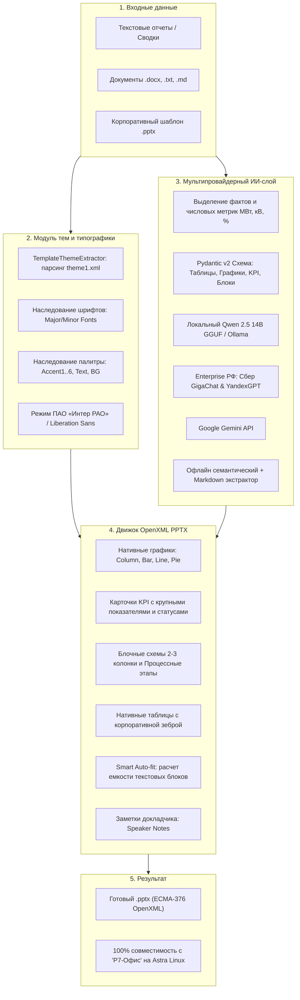

# ⚡ ЭнергоСлайд AI — Интеллектуальный генератор презентаций по корпоративному шаблону

> **Проект для Хакатона «ИИ-ассистенты для энергетики» (Трек «ИИ-помощник для подготовки презентаций»)**  
> Автоматическая трансформация неструктурированных рабочих материалов, отчетов и таблиц в редактируемые корпоративные презентации формата `.pptx`, строго соответствующие мастер-шаблону `Шаблон презентации_RUS_16x9.pptx` и оптимизированные для **«Р7-Офис» в среде Astra Linux**.

---

## 🏗️ Архитектура решения



---

## 🎯 Реализованные возможности

1. **Динамическая адаптация под любой загружаемый шаблон (`src/template_theme.py`)**:
   * **🎨 Автоматическое извлечение темы (`theme1.xml`)**: система парсит шрифтовую схему (`majorFont`, `minorFont`) и 6-цветную палитру акцентов из любого `.pptx`.
   * **✨ Наследование стилей**: таблицы, графики, карточки KPI и процессные блоки автоматически окрашиваются в фирменные цвета загруженного шаблона.
   * **🏛️ Корпоративный стандарт ПАО «Интер РАО»**: возможность в один клик принудительно зафиксировать эталонный синий стиль и гарнитуру **Liberation Sans**.

2. **Полная поддержка визуальных макетов корпоративного шаблона**:
   * **📊 Нативные графики и диаграммы**: гистограммы (`column`), линейчатые (`bar`), графики трендов (`line`), круговые (`pie`) с автоматическими Data Labels.
   * **🎯 KPI-карточки**: блоки ключевых показателей с крупными цифрами (28pt Bold), подписями и индикатором дельты (`+2.4%` / `-18%`).
   * **🧱 Блочные схемы**: многоколоночные контейнеры (2-3 колонки) со стилизованными шапками.
   * **➡️ Процессные цепочки**: дорожные карты и последовательности этапов (шевроны).
   * **📋 Нативные таблицы**: автогенерация с корпоративной заливкой шапки и полосатой «зеброй».
   * **💬 Заметки докладчика (Speaker Notes)**: генерация подсказок к каждому слайду в формате OpenXML и отображение в интерактивном окне.
   * **📝 Буллеты и автофит**: гарнитура **Liberation Sans**, динамический расчет кегля (zero-overflow гарантия для Р7-Офис).

3. **Интерактивный веб-интерфейс (Streamlit Live Editor)**:
   * **⚡ 1-Click Fast Fill**: Быстрый запуск 4 эталонных отраслевых сценариев ТЭК (ОЗП 2026-2027, Инвестпрограмма, Предиктивная аналитика, Надежность).
   * **➕ Вставка слайдов в произвольную позицию**: Добавление нового слайда с выбором точного номера расположения в презентации.
   * **🎛️ Интерактивный Live Editor**: Визуальное управление порядком слайдов (`⬆️ Вверх`, `⬇️ Вниз`), дублирование (`📋`) и удаление (`🗑️`).
   * **💬 Интерактивные заметки**: Редактирование текста речи спикера прямо под окном предпросмотра слайда.
   * **💾 JSON Импорт / Экспорт**: Мгновенное сохранение и загрузка структуры презентации для воспроизводимости.
   * **📊 Динамические редакторы**: Интерактивное редактирование таблиц `st.data_editor`, параметров диаграмм и карточек метрик.
   * **🌓 Адаптивная тема**: 100% читаемость и выверенные контрасты в Светлой и Тёмной темах оформления.

4. **Мультимодельный ИИ-бэкенд и поддержка Markdown**:
   * **📄 Нативный парсинг Markdown**: распознавание заголовков `##`/`###`, извлечение таблиц `| ... |`, очистка от лишних спецсимволов.
   * **🔷 Google Gemini API**: Сверхбыстрое структурирование через `gemini-flash-latest` / `gemini-3.5-flash` с автоповторами и обходом 404/503/429.
   * **🏢 Enterprise РФ**: Нативная интеграция со **Сбер GigaChat API** (`GigaChat`, `GigaChat-Pro`, `GigaChat-Max`) с обменом OAuth и **YandexGPT**.
   * **🔒 Локальный On-Premises / Air-Gapped**: Прямое исполнение `Qwen2.5-14B-Instruct-1M-Q3_K_L.gguf` (llama.cpp / Ollama) без интернета.
   * **⚡ Офлайн семантический экстрактор**: Мгновенный эвристический парсер (0 токенов, 0 внешних зависимостей).

---

## 🚀 Быстрый запуск

### Вариант 1: Запуск веб-приложения (Streamlit)

1. **Установка зависимостей:**
```bash
pip install -r requirements.txt
```

2. **Настройка окружения (опционально):**
Скопируйте `.env.example` в `.env` и укажите ваши ключи API (GigaChat / YandexGPT / Gemini / OpenAI).

3. **Запуск веб-интерфейса:**
```bash
streamlit run app.py
```
Интерфейс откроется в браузере по адресу: **http://localhost:8501**

---

### Вариант 2: Локальная модель Qwen 2.5 (GGUF)

1. Поместите файл `Qwen2.5-14B-Instruct-1M-Q3_K_L.gguf` в каталог `models/`.
2. Запустите локальный сервер:
```bash
scripts\run_local_llama_server.bat
```
3. В веб-интерфейсе выберите **⚡ Локальная GGUF** или **🦙 Ollama**.

---

### Вариант 3: Консольная генерация (CLI)

```bash
# Генерация из файла отчета
python cli.py --input "Дано/Задача 1 из 5Тест.docx" --template "Дано/Шаблон презентации_RUS_16x9.pptx" --output "result.pptx"

# Генерация эталонного демо-кейса
python cli.py --case case_ozp --output "ozp_presentation.pptx"
python cli.py --case case_predictive --output "predictive_presentation.pptx"
```

---

## 📂 Структура проекта

```
├── app.py                     # Веб-приложение Streamlit (Live Editor, Charts, KPI, Таблицы)
├── cli.py                     # Консольный интерфейс пакетной генерации
├── .env.example               # Шаблон переменных окружения и ключей API
├── requirements.txt           # Зависимости проекта
├── Dockerfile                 # Docker-образ с Liberation Sans для Astra Linux
├── docker-compose.yml         # Спецификация Docker Compose
├── docs/                      # Архитектурная и техническая документация
│   ├── architecture.md        # Сквозной пайплайн и описание подсистем
│   ├── astra_p7_compliance.md # Спецификация соответствия Р7-Офис / Astra Linux
│   └── llm_deployment.md      # Руководство по GigaChat, YandexGPT, GGUF и Ollama
├── models/                    # Локальные модели (.gguf, Modelfile)
│   ├── Modelfile              # Спецификация импорта в Ollama
│   └── Qwen2.5-14B-...gguf    # Локальная квантованная модель Qwen
├── scripts/                   # Скрипты запуска
│   ├── run_app.bat            # Запуск веб-приложения на Windows
│   ├── run_app.sh             # Запуск веб-приложения на Linux
│   └── run_local_llama_server.bat # Запуск сервера llama.cpp
├── src/                       # Исходный код ядра
│   ├── models.py              # Pydantic-модели слайдов (Таблицы, Графики, KPI, Блоки)
│   ├── template_theme.py      # Модуль извлечения стилей, шрифтов и палитр из PPTX
│   ├── pptx_engine.py         # OpenXML PPTX движок (Charts, Tables, KPI, Auto-fit)
│   ├── llm_extractor.py       # Мультимодельный экстрактор (GigaChat, YandexGPT, GGUF, Ollama)
│   └── demo_cases.py          # 4 эталонных отраслевых кейса из энергетики
├── templates/                 # Каталог шаблонов
│   ├── README.md              # Документация по работе с шаблонами
│   ├── master_rus_16x9.pptx   # Мастер-шаблон ПАО «Интер РАО»
│   └── template_example.pptx  # Пример альтернативного шаблона
├── tests/                     # Автоматизированные тесты
│   └── test_suite.py          # Комплексный тест генерации (8 unit-тестов)
└── Дано/                      # Исходные корпоративные шаблоны хакатона
```

---

## 🧪 Запуск тестов

```bash
python -m unittest tests/test_suite.py
```
Тест проверяет валидность всех OpenXML-структур, динамическое извлечение тем оформления, генерацию графиков, KPI-карточек, таблиц и блоков, а также сборку всех отраслевых демо-кейсов.


---
*Разработано командой «Огурец» в рамках хакатона «ИИ-ассистенты для энергетики» (2026).*